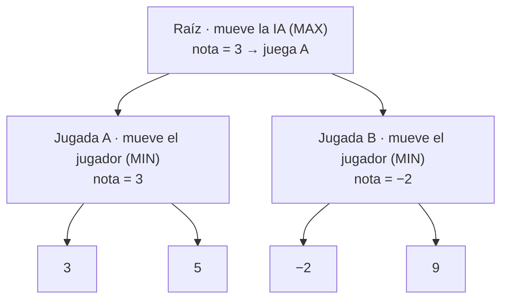
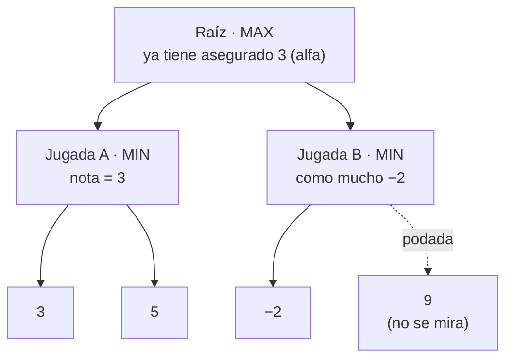

# La IA

Este documento explica cómo elige su jugada la IA (las negras). No hace falta saber nada de inteligencia artificial ni leer el código para entenderlo.

- Puntuar una posición: [`src/engine/ai/evaluate.js`](../src/engine/ai/evaluate.js)
- Buscar la mejor jugada: [`src/engine/ai/minimax.js`](../src/engine/ai/minimax.js)
- Generar las jugadas: `getAllLegalMoves` en [`src/engine/rules.js`](../src/engine/rules.js)
- Tests: `ai/evaluate.test.js`, `ai/minimax.test.js` y `ai/ai.test.js`

La idea en una frase: **la IA prueba sus jugadas, las respuestas del jugador, sus respuestas a esas respuestas… unas cuantas jugadas por delante, puntúa cómo queda el tablero al final de cada camino y elige el camino que le sale mejor suponiendo que el jugador juega lo mejor posible.**

Son tres piezas: una **evaluación** (¿cómo de buena es esta posición?), el **minimax** (¿qué jugada me lleva a la mejor posición?) y la **poda alfa-beta** (¿qué caminos puedo saltarme sin perder nada?).

## 1. La evaluación: ponerle nota a un tablero

`evaluate(state)` devuelve un número. **Cuanto más alto, mejor para la IA; cuanto más bajo, mejor para el jugador.** El 0 es una posición igualada.

### Partida terminada

Si la partida ya ha acabado, la nota es extrema y no se mira nada más:

| Situación | Nota |
|---|---|
| El jugador cumple el objetivo (llega a la casilla o da mate) | **−100 000** |
| El jugador no tiene jugadas en su turno (mate o ahogado) | **+100 000** |
| El jugador supera el límite de jugadas | **+100 000** |

Son los mismos criterios que usa `checkStatus` para decidir si la partida está ganada o perdida.

### Partida en curso

Se suman dos cosas:

**1. Material.** Cada pieza vale unos puntos. Se suman las negras y se restan las blancas:

| Peón | Caballo | Alfil | Torre | Dama | Rey |
|---|---|---|---|---|---|
| 100 | 320 | 330 | 500 | 900 | 0 |

El rey vale 0 porque nunca se captura: perderlo es perder la partida, y eso ya lo cubre la tabla de arriba.

**2. Objetivo.** En los niveles de tipo «llegar a una casilla», se restan **20 puntos por cada casilla** que el rey blanco se acerca a la meta. La distancia se cuenta en jugadas de rey (las diagonales cuentan como una).

> **Ejemplo (nivel `easy-1`).** Rey blanco en (4,0), meta en (4,7), una torre negra. Material: +500. El rey está a 7 casillas, lo más lejos posible, así que no se resta nada. **Nota: +500.** Si el rey avanzara hasta (4,5), a 2 casillas de la meta, la nota bajaría a 500 − 5 × 20 = **+400**.

## 2. Minimax: pensar varias jugadas por delante

Evaluar solo la posición que deja cada jugada no basta: una jugada que gana un caballo puede dejar la dama colgando. Por eso la IA mira **varias jugadas por delante**. A ese número de jugadas se le llama **profundidad** (las jugadas de los dos bandos cuentan).

Las posibilidades forman un **árbol**: la raíz es la posición actual, cada rama es una jugada y cada hoja es una posición que se evalúa. Luego las notas suben desde las hojas hasta la raíz siguiendo una regla:

- En los niveles donde **mueve la IA**, se queda con la nota **más alta** (MAX).
- En los niveles donde **mueve el jugador**, se supone que hará su mejor jugada, así que se queda con la **más baja** (MIN).

Ejemplo con profundidad 2 y dos jugadas por bando:

- Tras la jugada **A**, el jugador puede dejar la nota en 3 o en 5. Elegirá 3 (lo más bajo), así que A vale **3**.
- Tras la jugada **B**, el jugador puede dejarla en −2 o en 9. Elegirá −2, así que B vale **−2**, aunque haya un 9 tentador.
- La IA elige entre 3 y −2: juega **A**.

Esta es la clave del minimax: **no se fía de que el jugador se equivoque**. La jugada B parece buena por ese 9, pero un jugador que juegue bien nunca dejaría llegar ahí.

En el código, `findBestMove(state, depth)` prueba cada jugada de la IA, llama a `minimax` para puntuarla y devuelve la de nota más alta. `minimax` hace la misma operación de forma recursiva, alternando MAX y MIN según de quién sea el turno, hasta llegar a profundidad 0 o a una partida terminada.

### Ganar antes es mejor

Si dos caminos acaban en victoria, la IA prefiere el más corto. Para eso, a las victorias se les suma la profundidad que quedaba por explorar: un mate en la primera jugada vale más que un mate en la tercera. Del mismo modo, si va a perder, retrasa la derrota todo lo que puede.

## 3. La poda alfa-beta: no pensar lo que no hace falta

El árbol crece muy deprisa: si cada bando tiene 30 jugadas posibles, con profundidad 3 hay 30 × 30 × 30 = 27 000 posiciones. La poda permite **saltarse ramas enteras sin cambiar el resultado**.

Volvamos al ejemplo. La IA ya sabe que la jugada A le asegura un **3**. Ahora mira la jugada B y la primera respuesta del jugador da **−2**. En ese momento ya puede parar:

El jugador puede dejar B en −2 **o menos**: la segunda respuesta solo podría bajarla más. Como −2 es peor que el 3 que la IA ya tiene con A, la IA nunca elegirá B, mire lo que mire. No hace falta evaluar el 9.

Para esto el algoritmo lleva dos números mientras recorre el árbol:

- **alfa**: lo mínimo que **la IA** ya tiene asegurado por otro camino.
- **beta**: lo máximo que **el jugador** ya tiene asegurado por otro camino.

Cuando en una rama `beta ≤ alfa`, el otro bando nunca dejaría llegar hasta ahí y el resto de la rama se poda. Los tests comprueban que la poda da exactamente la misma nota que el minimax sin poda.

## 4. Rendimiento

Tiempos medidos en local con `findBestMove`:

| Posición | Profundidad 1 | Profundidad 2 | Profundidad 3 | Profundidad 4 |
|---|---|---|---|---|
| Nivel `easy-1` (2 piezas) | 3 ms | 3 ms | 20 ms | 30 ms |
| Posición de 12 piezas | 5 ms | 33 ms | 193 ms | 8,3 s |

Con profundidad 3 en la posición de 12 piezas, la poda baja el tiempo de **2,7 s a 0,19 s**: de unas 31 000 posiciones visitadas a una fracción.

El test de rendimiento (`ai.test.js`) exige **menos de 1 segundo con profundidad 3** en las dos posiciones. Es unas 5 veces lo medido en la de 12 piezas, para dejar margen en el CI.

> **Ojo con la profundidad 4.** En la posición de 12 piezas tarda unos 8 segundos, demasiado para la dificultad «difícil» prevista en la tarea 2.C3. Ordenar las jugadas para que la poda corte antes (tarea 4.A1) debería reducirlo mucho. Mientras tanto, conviene medirlo con los niveles reales antes de fijar `hard: 4`.

## 5. Límites conocidos

- **Horizonte.** La IA no ve más allá de su profundidad. Con profundidad 1 (fácil) no ve ninguna respuesta del jugador, así que no puede impedir que el rey llegue a la meta en la jugada siguiente. Los tests lo comprueban a partir de profundidad 2.
- **Ahogar también es ganar.** Según `checkStatus`, si el jugador no tiene jugadas en su turno, pierde. Por eso la IA puede elegir ahogar al rey en vez de darle mate: para ella valen lo mismo.
- **Empates.** Si varias jugadas tienen la misma nota, juega la primera que encuentra, recorriendo el tablero fila a fila.
- **Fuera de estas tareas:** el Web Worker (2.C2), las dificultades y la jugada aleatoria en «fácil» (2.C3), los obstáculos (3.B1) y la ordenación de jugadas (4.A1).

## 6. Qué comprueban los tests de la IA

| Test | Qué comprueba |
|---|---|
| Captura gratis | Si hay una pieza blanca sin defender, la captura; si hay varias, elige la más valiosa. |
| Mate en 1 | Si puede ganar en una jugada, lo hace; si la única forma es el mate, lo encuentra. |
| Evitar el mate | Ante una amenaza de mate de pasillo, juega algo que la impide. |
| Impedir el objetivo | Si el rey blanco está a una casilla de la meta, se la bloquea. |
| Jugada legal | En el nivel de ejemplo siempre devuelve una jugada legal. |
| Rendimiento | Profundidad 3 en menos de 1 s. |
