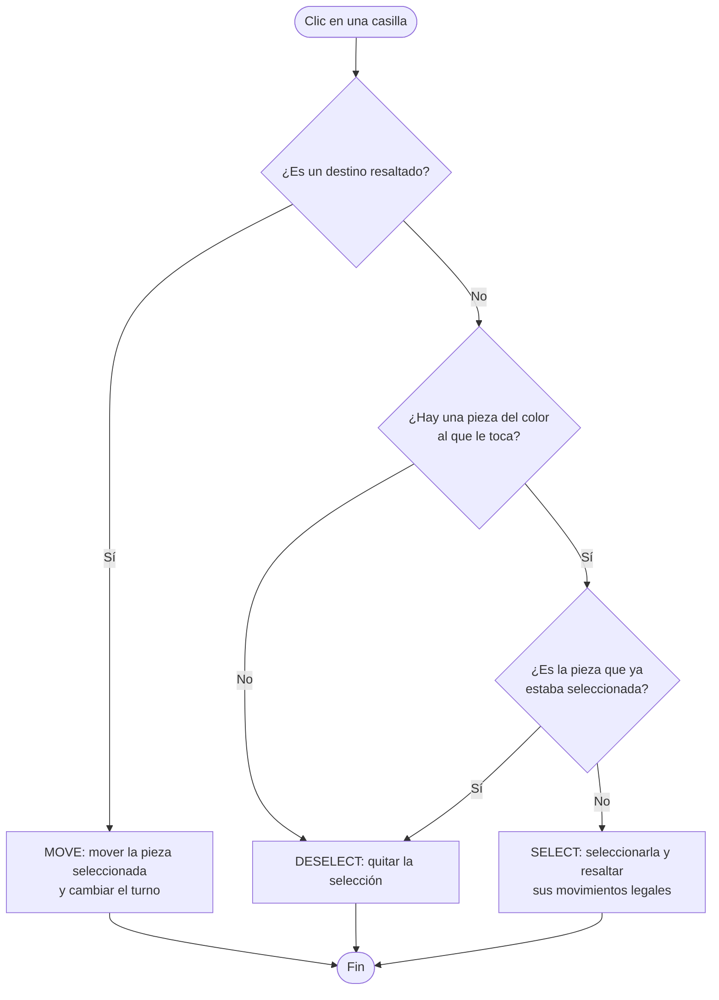

# Reglas del juego

Este documento explica cómo decide el motor qué jugadas se pueden hacer, cuándo hay jaque, jaque mate o ahogado, y cómo responde la pantalla de juego a los clics. No hace falta leer el código para entenderlo.

- Movimientos de cada pieza: [`src/engine/pieces/`](../src/engine/pieces/)
- Reglas (jaque, mate, ahogado): [`src/engine/rules.js`](../src/engine/rules.js)
- Aplicar una jugada: `applyMove` en [`src/engine/index.js`](../src/engine/index.js)
- Clics en el tablero: [`src/pages/Game.jsx`](../src/pages/Game.jsx)
- Tests: `pieces/pieces.test.js`, `rules.test.js` y `pages/Game.test.jsx`

## Coordenadas

El tablero es la matriz `board[y][x]` descrita en [estado.md](estado.md): `x` es la columna, `y` la fila, y ambas empiezan en 0. **`y = 0` es la fila de arriba.** Las blancas (el jugador) empiezan arriba y **avanzan hacia `y` creciente**; las negras (la IA) avanzan hacia `y` decreciente. Es lo que usan los niveles: en `easy-1` el rey blanco sale de `y = 0` y su meta está en `y = 7`.

## 1. Movimientos de cada pieza

Cada pieza tiene un archivo en `engine/pieces/` con la misma función:

```js
getMoves(board, from, piece) // → lista de casillas destino [{ x, y }, ...]
```

`pieces/index.js` reúne las seis en un registro, `PIECES`, para poder llamar a `PIECES[piece.type].getMoves(...)` sin saber qué pieza es.

Estas funciones solo miran **cómo se mueve la pieza**: no comprueban si el rey queda en jaque (eso es el paso 2) ni tienen en cuenta los obstáculos (Fase 3).

Hay dos formas de moverse, y cada una tiene su función auxiliar en `pieces/slide.js`:

**Piezas que se deslizan** (torre, alfil, dama) usan `slide`. En cada dirección avanzan casilla a casilla hasta que:

- salen del tablero → paran;
- encuentran una pieza **propia** → paran *antes* de ella;
- encuentran una pieza **enemiga** → la incluyen (es una captura) y paran.

**Piezas de salto** (rey, caballo) usan `jump`. Prueban una lista fija de desplazamientos y se quedan con los que caen dentro del tablero y no tienen una pieza propia. Lo que haya en medio no importa: por eso el caballo salta por encima de las piezas.

| Pieza | Tipo | Direcciones / saltos | En el centro de un tablero vacío |
|---|---|---|---|
| Torre | desliza | horizontal y vertical | 14 casillas |
| Alfil | desliza | las 4 diagonales | 13 casillas |
| Dama | desliza | las 8 direcciones | 27 casillas |
| Rey | salta | 1 casilla en las 8 direcciones | 8 casillas |
| Caballo | salta | en «L»: (±1, ±2) y (±2, ±1) | 8 casillas |
| Peón | propio | ver abajo | 1 casilla |

**El peón** es especial porque no captura como se mueve:

- Avanza **una** casilla hacia delante si está vacía.
- Desde su fila inicial (la segunda de su lado: `y = 1` las blancas, la penúltima las negras) puede avanzar **dos** si las dos casillas están vacías.
- **Captura** una casilla en diagonal hacia delante, y solo si hay una pieza enemiga.
- Si llega a la última fila, **corona en dama** (lo hace `applyMove`, ver el paso 4).

No hay enroque ni captura al paso: los niveles son puzles cortos y no los necesitan.

## 2. Movimientos legales

Que una pieza *pueda* ir a una casilla no significa que la jugada sea **legal**: en ajedrez está prohibido dejar a tu propio rey en jaque. `getLegalMoves` lo resuelve **simulando** cada jugada:

```js
function getLegalMoves(state, from) {
  const piece = getPiece(state.board, from);
  if (!piece) return [];
  const candidates = PIECES[piece.type].getMoves(state.board, from, piece);
  return candidates.filter((to) => {
    const after = movePiece(state.board, from, to); // simulamos la jugada
    return !isInCheck(after, piece.color);          // ¿mi rey queda en jaque?
  });
}
```

Con esta única comprobación salen gratis todas las reglas del rey:

- **Pieza clavada**: si una pieza tapa un ataque a su rey, al apartarla el rey quedaría en jaque, así que esos movimientos se descartan. Puede moverse, eso sí, a lo largo de la línea del ataque.
- **El rey no puede meterse en jaque**: las casillas atacadas se descartan, y también capturar una pieza que está defendida.
- **Estando en jaque**, solo quedan las jugadas que lo resuelven: apartar el rey, tapar el ataque o capturar la pieza que lo da.

`getLegalMoves` **no comprueba el turno**: la IA la usa para calcular las jugadas de las negras. El turno lo controla `applyMove`.

## 3. Jaque, jaque mate y ahogado

**Casilla atacada** (`isAttacked(board, casilla, color)`): una casilla está atacada si alguna pieza de ese color tiene esa casilla entre sus movimientos (`getMoves`). Con el peón funciona bien porque solo puede ir en diagonal cuando hay una pieza enemiga, y el rey lo es.

**Jaque** (`isInCheck(board, color)`): se busca el rey de ese color con `findPiece` y se mira si su casilla está atacada por el color contrario. Si ese color **no tiene rey** (pasa en algunos niveles, por ejemplo `easy-1` no tiene rey negro), nunca está en jaque.

**Tiene jugadas** (`hasAnyLegalMove(state, color)`): recorre todas las piezas de ese color y para en cuanto una tiene al menos un movimiento legal.

Con esas dos preguntas se distinguen los finales:

| ¿Está en jaque? | ¿Tiene alguna jugada legal? | Resultado | Función |
|---|---|---|---|
| sí | sí | jaque: tiene que resolverlo | `isInCheck` |
| sí | **no** | **jaque mate** | `isCheckmate` |
| no | **no** | **ahogado** (tablas) | `isStalemate` |
| no | sí | partida normal | — |

Las posiciones de los tests (`rules.test.js`) son ejemplos de cada caso: el mate del pasillo, el mate de dama apoyada por el rey, dos ahogados y varias posiciones que *parecen* mate pero no lo son.

> Decidir quién gana el nivel (`checkStatus`) es la tarea 2.A1: usará `isCheckmate` para los niveles con objetivo `checkmate`.

## 4. Aplicar una jugada

`applyMove(state, move)` devuelve un estado **nuevo** con la pieza movida, el turno cambiado, la jugada sumada a `moveCount` (solo las blancas) y guardada en `history`.

Antes comprueba que la jugada sea válida: que haya una pieza en el origen, que sea del color al que le toca (`state.turn`) y que el destino esté entre sus movimientos legales. Si algo falla, **devuelve el mismo estado sin cambios**, en lugar de lanzar un error, para que la interfaz no se rompa por un clic raro.

Si la pieza es un peón y llega a la última fila (`y = 7` las blancas, `y = 0` las negras), se convierte en **dama** y conserva su `id`.

## 5. Clics en el tablero

La pantalla de juego (`Game.jsx`) decide qué hacer con cada clic y se lo pide al reducer con una acción:



Al seleccionar, el reducer guarda la casilla en `state.selected` y sus movimientos legales en `state.highlights`. El tablero los dibuja así:

- **Casilla seleccionada**: borde interior oscuro.
- **Destino vacío**: un punto azul en el centro.
- **Destino con pieza enemiga** (captura): un anillo azul alrededor de la pieza.

Tras mover o deseleccionar, `selected` vuelve a `null` y `highlights` a `[]`.

## Qué queda fuera (por ahora)

| Qué | Dónde se hará |
|---|---|
| Obstáculos que bloquean casillas | Fase 3, tareas 3.B1–3.B4 |
| Ganar o perder el nivel (`checkStatus`) | Fase 2, tarea 2.A1 |
| Jugadas de la IA | Fase 2, tareas 2.B1–2.B3 |
| Enroque, captura al paso y elegir pieza al coronar | No están previstos |
